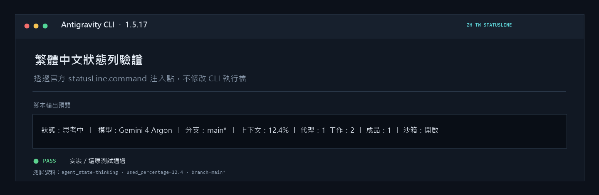

# Antigravity CLI 繁體中文增補包（台灣）

為 Google Antigravity CLI 加入台灣繁體中文的代理回覆規則與自訂狀態列。

> **範圍說明：** Antigravity CLI 1.5.17 公開專案目前提供 README、變更記錄與範例，未公開 TUI 字串資源或 UI 原始碼；官方設定文件也沒有提供介面語言／`locale` 設定。因此本套件不會假裝能完整翻譯 CLI 內建選單、命令、提示與錯誤訊息，也不會修改或替換官方執行檔。它使用官方支援的自訂設定注入點，將代理的自然語言回覆與狀態列本地化。

## 功能

- **代理回覆使用台灣繁體中文：** 安裝器會將一段可辨識、可安全移除的規則加入 `~/.gemini/config/AGENTS.md`。該路徑是 Antigravity 的全域設定，因此 Antigravity CLI 與 Antigravity App 的代理回覆都會套用此規則。
- **繁體中文狀態列：** 透過 `~/.gemini/antigravity-cli/settings.json` 的 `statusLine.command` 設定，顯示代理狀態、模型、Git 分支、上下文用量、背景工作與沙箱狀態。
- **`/zh-tw` 技能：** 安裝為全域技能；可在 CLI 中執行 `/zh-tw`，重新套用繁體中文回覆與用語規範。
- **保留原有設定：** 安裝前備份既有 `statusLine` 設定；解除安裝時只移除本套件區塊，並在原設定未被使用者另行更改時還原。
- **Windows、macOS、Linux：** 提供 PowerShell 與 Bash 安裝器。

## 安裝

### Windows PowerShell

在此專案資料夾中執行：

```powershell
Set-ExecutionPolicy -Scope Process Bypass
.\install.ps1
```

### macOS / Linux

```bash
chmod +x install.sh
./install.sh
```

完成後，重新啟動 Antigravity CLI。繁體中文代理回覆規則會自動載入；狀態列亦會由 CLI 的官方 `statusLine` 設定啟用。

## 使用與驗證

1. 執行 `agy`，確認狀態列出現「準備就緒」、「模型」、「上下文」等繁體中文標籤。
2. 傳送一般問題，代理應以台灣繁體中文回覆。
3. 執行 `/zh-tw` 可再次明確套用用語規則。
4. `/skills` 可確認 `zh-tw` 技能已載入；`/config` 可檢視狀態列相關設定。

狀態列腳本只讀取 CLI 傳入的 JSON，不會呼叫網路、讀取專案檔案或修改對話內容。腳本遇到未知狀態時會保留原始值，避免隱藏新版本新增的狀態。

### 成功畫面

以下畫面是本套件狀態列腳本接收官方範例 JSON 後的實際輸出預覽。CLI 其他內建介面文字維持英文；本套件不宣稱已翻譯整個 TUI。



## 注入點與設定

Antigravity CLI 的官方公開設定位置為 `~/.gemini/antigravity-cli/settings.json`，支援透過 `statusLine` 物件執行自訂命令，並將工作階段 JSON 從標準輸入傳給命令。本套件只使用此官方擴充點；沒有透過二進位修補、執行期攔截或 Electron `asar` 替換注入翻譯。

套件另外使用 Antigravity 的全域 `AGENTS.md` 與 Agent Skills 載入規則，將繁體中文用語指示提供給代理。`settings.json` 本身沒有官方的 UI 語言鍵；`LANG`／`LC_ALL` 也不是 CLI 介面翻譯設定。

| 項目 | 本套件用法 | 官方支援路徑 |
| --- | --- | --- |
| 代理預設回覆語言 | 台灣繁體中文規則 | `~/.gemini/config/AGENTS.md` |
| 可手動呼叫的翻譯技能 | `/zh-tw` | `~/.gemini/antigravity-cli/skills/zh-tw/SKILL.md` |
| CLI 自訂狀態列 | `statusLine.command` | `~/.gemini/antigravity-cli/settings.json` |
| 內建選單／提示／錯誤 | 不修改，仍以官方版本為準 | 公開設定未提供語言包注入鍵 |

## 解除安裝

Windows：

```powershell
.\uninstall.ps1
```

macOS / Linux：

```bash
./uninstall.sh
```

安裝器只會刪除自己新增的 `AGENTS.md` 標記區塊、`zh-tw` 技能及狀態列設定。若安裝後您自行改過 `statusLine`，解除安裝時會保留目前設定，不會覆寫您的變更。

## 測試

Windows：

```powershell
.\scripts\verify.ps1
```

此測試會在暫存目錄驗證中英文字串、設定合併、重複安裝、既有狀態列備份／還原及解除安裝，不會更動目前使用者設定。

macOS / Linux 安裝器設定測試：

```bash
python3 scripts/verify_unix.py
```

## 參考資料

- [Antigravity CLI 官方專案](https://github.com/google-antigravity/antigravity-cli)
- [Antigravity CLI 設定文件](https://antigravity.google/docs/cli-settings)
- [狀態列自訂文件](https://antigravity.google/docs/cli/statusline/)
- [Agent Skills 文件](https://antigravity.google/docs/skills)
- [Antigravity 台灣繁體中文 App 在地化專案](https://github.com/atonnyshen/antigravity2-TW)（參考台灣軟體用語；其 App 二進位注入方式不適用於 CLI）
