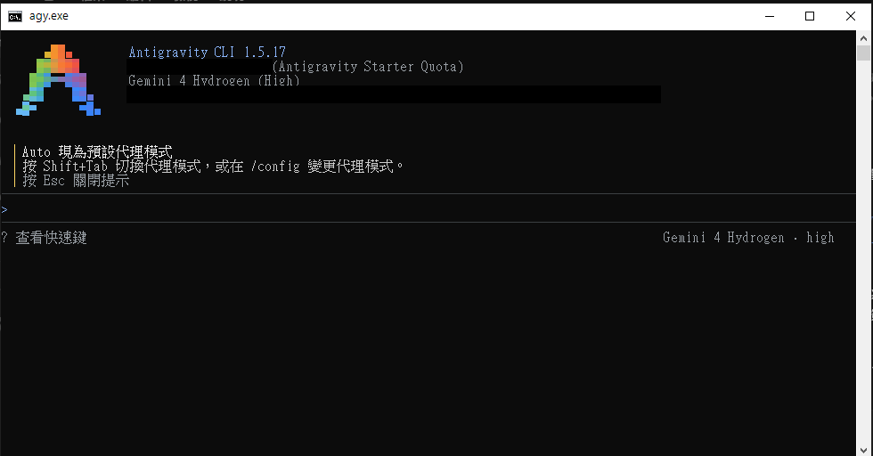

# Antigravity CLI 繁體中文增補包（台灣）

為 Google Antigravity CLI 加入台灣繁體中文代理回覆與狀態列，並提供 Windows 外部啟動器，嘗試翻譯部分內建終端介面文字。

> **兩種途徑、不同範圍：** 官方支援的設定增補包只處理代理回覆與狀態列；Windows 外部啟動器則透過 ConPTY 轉譯部分 TUI 文字。Antigravity CLI 沒有公開的 UI 語言／`locale` 設定或字串資源，因此外部啟動器屬於非官方、依版本維護的實驗性做法，並非完整語言包。

## 功能

- **代理回覆使用台灣繁體中文：** 安裝器會將一段可辨識、可安全移除的規則加入 `~/.gemini/config/AGENTS.md`。該路徑是 Antigravity 的全域設定，因此 Antigravity CLI 與 Antigravity App 的代理回覆都會套用此規則。
- **繁體中文狀態列：** 透過 `~/.gemini/antigravity-cli/settings.json` 的 `statusLine.command` 設定，顯示代理狀態、模型、Git 分支、上下文用量、背景工作與沙箱狀態；排版會估算中日韓寬字元的終端欄位數，避免按字元數判斷造成的中文溢位。
- **`/zh-tw` 技能：** 安裝為全域技能；可在 CLI 中執行 `/zh-tw`，重新套用繁體中文回覆與用語規範。
- **保留原有設定：** 安裝前備份既有 `statusLine` 設定；解除安裝時只移除本套件區塊，並在原設定未被使用者另行更改時還原。
- **Windows、macOS、Linux：** 提供 PowerShell 與 Bash 安裝器。
- **Windows 部分 TUI 翻譯（選用）：** `launcher/windows/agy-tw.cmd` 以外部啟動器透過 Windows ConPTY 啟動原始 `agy.exe`，並翻譯已收錄的主畫面提示、一般資訊頁、指令清單、快捷鍵標籤與工作區確認文字。

## 選擇使用途徑

| 途徑 | 適用內容 | 技術方式 | 支援性 |
| --- | --- | --- | --- |
| **A. 官方設定增補包（建議）** | 代理回覆、狀態列、`/zh-tw` 技能 | `AGENTS.md`、Agent Skill、`statusLine.command` | 使用 CLI 公開設定，不改動終端 UI 或執行檔 |
| **B. Windows 外部啟動器（實驗性）** | 部分主畫面、一般資訊／指令／快捷鍵頁面與確認提示 | 啟動原版 `agy.exe`，經 ConPTY 轉譯 UTF-8／VT 輸出 | 非官方、字串依版本維護；不保證覆蓋全部畫面 |

兩者可同時使用：先安裝 A，再以 B 啟動 CLI。直接輸入 `agy` 仍會使用原始 CLI，不會套用 B 的 TUI 轉譯。

## 安裝

### Windows PowerShell

在此專案資料夾中執行：

```powershell
Set-ExecutionPolicy -Scope Process Bypass
.\install.ps1
```

### macOS / Linux

需要 Python 3。安裝器會先檢查必要來源檔、現有 JSON 與目標目錄的寫入能力；狀態列直接設定為 `python3 <安裝路徑>/statusline-tw.py`，不再透過 Bash 包裝器轉呼叫另一段 `python3 -c`。

```bash
chmod +x install.sh
./install.sh
```

完成後，重新啟動 Antigravity CLI。繁體中文代理回覆規則會自動載入；狀態列亦會由 CLI 的官方 `statusLine` 設定啟用。

### B. Windows 外部啟動器＋偽終端機（選用）

在專案資料夾以命令提示字元或 PowerShell 執行：

```powershell
.\launcher\windows\agy-tw.cmd
```

啟動器會優先使用 `AGY_EXE` 環境變數指定的執行檔，其次使用 PATH 中的 `agy.exe`，最後嘗試 `%LOCALAPPDATA%\agy\bin\agy.exe`。也可直接傳遞 CLI 參數：

```powershell
.\launcher\windows\agy-tw.cmd --help
```

若使用自訂安裝位置，可先設定：

```powershell
$env:AGY_EXE = 'C:\path\to\agy.exe'
.\launcher\windows\agy-tw.cmd
```

此途徑只支援 Windows 10 1809 以上的 ConPTY 環境，需有內建 Windows PowerShell。啟動前會實際探測能否建立偽終端；若失敗會提示原因並建議改用途徑 A。它不替換、修改或重新簽署 `agy.exe`，也不注入 DLL／程序記憶體；啟動器會建立獨立偽終端機，將輸入轉送給原執行檔，並對部分 UTF-8／VT 輸出字串做替換。使用者仍由原 CLI 執行登入、工作區信任、工具權限與對話操作。

**目前涵蓋：** 已依 Antigravity CLI 1.5.17 的實際介面與使用者提供的截圖，補上主畫面提示、「一般／指令／快速鍵」說明頁、可見的 49 個斜線指令說明、27 個鍵盤快速鍵說明、頁籤／導覽提示及工作區信任提示。對 CLI 先行截短的指令說明另有前綴對應，避免英文省略文字漏出。

**仍有限制：** 版本、路徑、帳號、模型與強度等動態資訊刻意保留原文；AI 回覆、工具輸出、專案內容、命令列錯誤、尚未觀察到的對話框／設定子頁及新版本新增字串不在固定字串映射範圍。因此可涵蓋目前已觀察的主要固定介面，但不能保證整個 CLI 的所有畫面都完整在地化。CLI 更新後若更改字串、ANSI 分段或畫面排版，映射可能失效或造成欄位寬度變化。非 Windows 使用者請使用途徑 A。

## 使用與驗證

1. 執行 `agy`，確認狀態列出現「準備就緒」、「模型」、「上下文」等繁體中文標籤。
2. 傳送一般問題，代理應以台灣繁體中文回覆。
3. 執行 `/zh-tw` 可再次明確套用用語規則。
4. `/skills` 可確認 `zh-tw` 技能已載入；`/config` 可檢視狀態列相關設定。

狀態列腳本只讀取 CLI 傳入的 JSON，不會呼叫網路、讀取專案檔案或修改對話內容。腳本遇到未知狀態時會保留原始值，避免隱藏新版本新增的狀態。

### 途徑 A：狀態列輸出預覽

以下畫面是途徑 A 的狀態列腳本接收官方範例 JSON 後的實際輸出預覽。途徑 A 不翻譯 CLI 內建介面；途徑 B 僅翻譯上方列出的部分 TUI 固定字串，不代表整個介面已完整在地化。


### 途徑 B：CLI 主畫面實機畫面

以下為透過 `agy-tw.cmd` 啟動原版 CLI 的實際畫面。主畫面的 Auto 模式提示與 `?` 快捷鍵提示已顯示繁體中文；版本、帳號、工作路徑與右下角模型／強度維持原文。快速參考、指令與快速鍵頁也已逐項補齊固定說明。



## 注入點與設定

Antigravity CLI 的官方公開設定位置為 `~/.gemini/antigravity-cli/settings.json`，支援透過 `statusLine` 物件執行自訂命令，並將工作階段 JSON 從標準輸入傳給命令。途徑 A 只使用此官方擴充點；途徑 B 則是獨立的輸出轉譯器，不改寫 CLI 本體。

Unix 狀態列由純 Python 檔案 `statusline-tw.py` 處理，使用 Python 內建 `unicodedata.east_asian_width` 計算全形字元的顯示欄位，無需安裝 `wcwidth`。Windows 狀態列採用對應的 PowerShell 寬字元估算。安裝器會在寫入前檢查套件來源、解析現有 JSON，並測試目標目錄可寫；Unix 新建 `AGENTS.md` 使用 `0644`，設定與安裝狀態檔仍採較嚴格的 `0600`。Windows 安裝器會在變更前驗證來源、JSON 與目錄寫入能力，寫入失敗時嘗試還原原檔。

套件另外使用 Antigravity 的全域 `AGENTS.md` 與 Agent Skills 載入規則，將繁體中文用語指示提供給代理。`settings.json` 本身沒有官方的 UI 語言鍵；`LANG`／`LC_ALL` 也不是 CLI 介面翻譯設定。

| 項目 | 本套件用法 | 官方支援路徑 |
| --- | --- | --- |
| 代理預設回覆語言 | 台灣繁體中文規則 | `~/.gemini/config/AGENTS.md` |
| 可手動呼叫的翻譯技能 | `/zh-tw` | `~/.gemini/antigravity-cli/skills/zh-tw/SKILL.md` |
| CLI 自訂狀態列 | `statusLine.command` | `~/.gemini/antigravity-cli/settings.json` |
| 內建選單／提示／錯誤 | A 不處理；B 僅轉譯已收錄的文字 | 公開設定未提供語言包注入鍵；B 使用 Windows ConPTY |

外部啟動器依賴 Windows 的偽終端機通道。ConPTY 會以 UTF-8 文字與 VT 序列承載終端輸入／輸出，終端主機負責轉送並呈現內容；本專案的啟動器就在這個輸出通道替換少量固定字串，而不是對 CLI 執行檔做二進位補丁或程序注入。

## 解除安裝

Windows：

```powershell
.\uninstall.ps1
```

macOS / Linux：

```bash
./uninstall.sh
```

安裝器只會刪除自己新增的 `AGENTS.md` 標記區塊、`zh-tw` 技能及狀態列設定。若安裝後您自行改過 `statusLine`，解除安裝時會保留目前設定，不會覆寫您的變更。

## 測試

Windows：

```powershell
.\scripts\verify.ps1
.\scripts\verify_launcher.ps1
```

此測試會在暫存目錄驗證中英文字串、設定合併、重複安裝、既有狀態列備份／還原及解除安裝，不會更動目前使用者設定。
`verify_launcher.ps1` 會編譯啟動器中的 VT 字串轉譯器、執行 ConPTY 可用性探測，並逐項檢查已收錄的 49 個指令說明、27 個快速鍵說明及主要頁尾提示；不會啟動代理或呼叫模型。

macOS / Linux 安裝器設定測試：

```bash
python3 scripts/verify_unix.py
```

此測試會在含空白的暫存路徑安裝狀態列，並以設定檔中的完整 `statusLine.command` 實際啟動它、餵入 JSON，再驗證繁中輸出；不是只檢查設定值是否包含腳本檔名。

Windows 外部啟動器先前在 Antigravity CLI 1.5.17 上確認可透過原始 `agy.exe` 執行 `--version`、`--help`；實際互動畫面確認工作區信任提示、主畫面、一般／指令／快速鍵頁可轉譯。本次以 CLI 1.5.18 內建固定字串補齊 49 個指令說明與 27 個快速鍵說明（含窄終端機截短文字的對應），並以逐項 VT 輸出測試驗證；`--version` 透過啟動器亦正常。這是針對已觀察固定介面的擴充翻譯，並不代表所有動態或未觀察頁面都完成在地化。

## 參考資料

- [Antigravity CLI 官方專案](https://github.com/google-antigravity/antigravity-cli)
- [Antigravity CLI 設定文件](https://antigravity.google/docs/cli-settings)
- [狀態列自訂文件](https://antigravity.google/docs/cli/statusline/)
- [Agent Skills 文件](https://antigravity.google/docs/skills)
- [Antigravity 台灣繁體中文 App 在地化專案](https://github.com/atonnyshen/antigravity2-TW)（參考台灣軟體用語；其 App 二進位注入方式不適用於 CLI）
- [Microsoft Learn：建立 ConPTY 偽終端機工作階段](https://learn.microsoft.com/en-us/windows/console/creating-a-pseudoconsole-session)
- [Microsoft Learn：CreatePseudoConsole](https://learn.microsoft.com/en-us/windows/console/createpseudoconsole)
