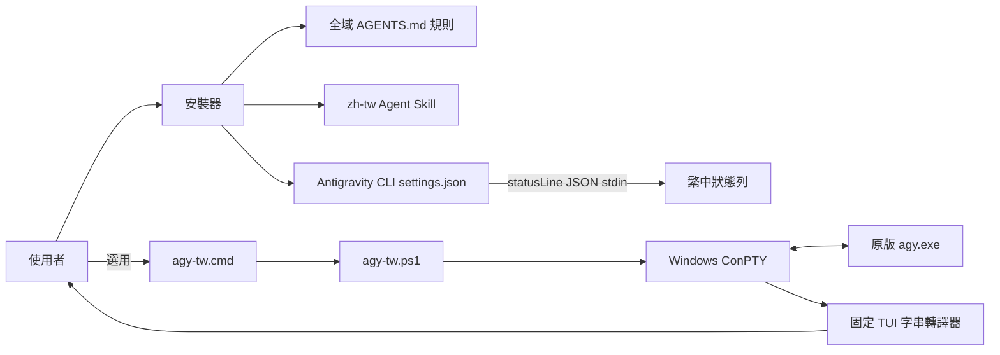

# 專案架構

本文說明 AGY-CLI-TW 的模組、資料流、設定責任與安全邊界。專案保留兩條使用途徑：官方設定增補包（A）與 Windows 實驗性 ConPTY 啟動器（B）。途徑 B 的政策適用性尚無針對此類 UI wrapper 的明確說明，詳見[產品規劃](PRODUCT-PLAN.md)。

## 系統概觀



## 兩條使用途徑

### A. 官方設定增補包

途徑 A 不攔截 CLI 畫面，也不修改 `agy.exe`。安裝器把專案資源合併到使用者的 Antigravity 設定目錄：

| 資源 | 安裝位置 | 用途 |
| --- | --- | --- |
| `resources/AGENTS.zh-TW.md` | `~/.gemini/config/AGENTS.md` 的標記區塊 | 提示代理使用台灣繁體中文及本地用語 |
| `skills/zh-tw/SKILL.md` | `~/.gemini/antigravity-cli/skills/zh-tw/SKILL.md` | 提供可由 `/zh-tw` 呼叫的在地化技能 |
| `statusline-tw.py` 或 `statusline-tw.ps1` | `~/.gemini/antigravity-cli/` | 將 CLI 傳入的工作階段 JSON 轉成繁中狀態列 |
| `settings.json` 中的 `statusLine` | `~/.gemini/antigravity-cli/settings.json` | 指定要執行的狀態列程式 |

資料流：CLI 將狀態 JSON 寫入標準輸入 → 狀態列程式解析欄位 → 依終端機欄位寬度格式化 → 輸出文字至標準輸出。狀態列只處理傳入資料，不呼叫網路，也不讀取專案檔案。

安裝器會在寫入前檢查必要來源、JSON 格式與目錄可寫性；Unix 使用原子替換，Windows 保存快照並在寫入失敗時嘗試回滾。安裝狀態檔保存原始 `statusLine` 與本套件設定。解除安裝只在設定仍等於本套件安裝值時還原，若偵測到使用者後續修改則保留現值。

### B. Windows 外部啟動器（實驗性）

途徑 B 使用 `launcher/windows/agy-tw.cmd` 作為入口，轉交給 `agy-tw.ps1`。啟動器解析原版 `agy.exe` 路徑，先探測 ConPTY 是否可建立，再透過 Windows Pseudo Console 啟動原執行檔。它是互動式 UI wrapper，不使用 `agy -p`，也不會再呼叫 AI 代理；但 Google FAQ／服務條款對第三方軟體存取 Antigravity 有廣泛文字，目前沒有專門說明 ConPTY 在地化啟動器，因此文件不對其政策適用性作確定結論。

```mermaid
sequenceDiagram
  participant U as 使用者
  participant C as agy-tw.cmd
  participant P as agy-tw.ps1 / C# bridge
  participant T as ConPTY
  participant A as 原版 agy.exe
  U->>C: 啟動並傳入 CLI 參數
  C->>P: 呼叫 PowerShell 啟動器
  P->>P: 探測 CreatePseudoConsole
  P->>T: 建立偽終端機
  P->>A: 以偽終端機啟動原執行檔
  U<->>T: 輸入與互動
  A-->>T: UTF-8 / VT 輸出
  T-->>P: 讀取終端輸出
  P-->>U: 替換已知固定字串後轉送
```

轉譯器保留 VT 控制序列，只處理已收錄的 UI 字串、頁籤標籤與 CLI 依寬度截短的說明。版本、帳號、路徑、模型、使用者內容、AI 回覆、工具輸出及錯誤訊息不做普遍翻譯。此途徑依 CLI 版本、字串分段和終端寬度而異；沒有公開的官方 UI locale 資源，因此不能視為完整語言包。

ConPTY 不可用時，啟動器會顯示失敗原因並建議改用途徑 A。啟動器不修改、注入或重新簽署 `agy.exe`；這是技術邊界說明，不等同於 Google 對政策適用性的明確認可。

## 原始碼目錄

| 路徑 | 責任 |
| --- | --- |
| `resources/` | 可合併至全域代理規則的繁中內容 |
| `skills/` | 可由 CLI 呼叫的繁中 Agent Skill |
| `statusline-tw.py` | Unix/macOS/Linux 純 Python 狀態列與 CJK 顯示寬度處理 |
| `statusline-tw.ps1` | Windows PowerShell 狀態列與 CJK 顯示寬度處理 |
| `scripts/manage_unix.py` | Unix 安裝／解除安裝、JSON 合併、備份狀態與原子寫入 |
| `install.sh`, `uninstall.sh` | Unix 入口腳本，檢查 Python 3 後呼叫管理程式 |
| `install.ps1`, `uninstall.ps1` | Windows 安裝／解除安裝、預檢、快照與回滾 |
| `launcher/windows/` | Windows CMD 入口及 PowerShell/C# ConPTY 啟動器 |
| `scripts/verify*.ps1`, `scripts/verify_unix.py` | 安裝、狀態列、翻譯映射與 ConPTY 探測驗證 |
| `scripts/render-preview.ps1`, `docs/images/` | 狀態列預覽產生器及 README 圖片 |

## 安全與相容性邊界

- 安裝器只管理本專案標記區塊、Skill、狀態列檔案及對應設定；使用者自訂值應保留。
- 狀態列輸入視為不可信資料，需容忍 JSON 欄位缺漏、型別錯誤、未知狀態與超長欄位。
- 途徑 B 只啟動互動式 `agy.exe`，不使用 `agy -p`，也不由 Codex 等外部 AI 代理編排；它仍是 wrapper，需將 Google 公開政策文字納入風險評估。
- Windows TUI 轉譯需要 Windows 10 1809 以上的 ConPTY 與 Windows PowerShell；其他平台使用途徑 A。
- 截圖、範例輸出、測試日誌與文件不得提交可識別帳號、信箱、個人路徑或其他私密資料；若敏感內容已進入 Git 歷史，單純新增遮蔽版並不足以移除舊物件。
