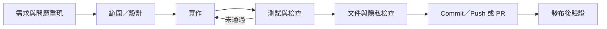

# SD（Software Development）開發流程

本文定義 AGY-CLI-TW 從需求、設計、實作、驗證到提交的維護流程。由於專案跨 Windows 與 Unix，任何變更都要明確標示影響途徑 A（官方設定）或途徑 B（Windows ConPTY），避免只在單一平台成立。

## 開發生命週期

### 1. 需求與範圍

每項工作先記錄：使用者可觀察到的問題、重現方式、影響平台、所屬途徑、預期行為，以及不在範圍內的項目。若需求涉及 CLI 內建文字，記下驗證過的 CLI 版本；若涉及設定，列明安裝器可能修改及必須保留的路徑。

### 2. 設計

- 優先選擇官方公開設定（`AGENTS.md`、Skill、`statusLine.command`）；只有官方介面不足時才改動實驗性啟動器。
- 定義輸入／輸出契約、失敗處理、跨平台差異、回滾策略及隱私影響。
- 安裝與解除安裝必須成對設計：記錄原始值、只移除本專案資料、避免覆蓋安裝後使用者自行修改的設定。
- 若需新增依賴、外部資料檔或 Git 歷史重寫，先評估部署、相容性和協作者影響，並在變更說明中列出。

### 3. 實作

- 一次修改聚焦一個需求，維持 Python 標準函式庫與既有 PowerShell 相容性，除非需求明確需要新依賴。
- Unix/macOS 與 Windows 的狀態列應維持一致欄位語意；新增欄位需考慮 CJK 欄寬、終端寬度、截斷及換行。
- ConPTY 映射只翻譯已觀察的固定字串；不得以過度寬泛的替換誤改帳號、路徑、模型、使用者內容或其他動態文字。
- 安裝器變更需涵蓋來源檔缺失、壞 JSON、目錄不可寫、重複安裝、使用者後改設定及解除安裝情境。

### 4. 驗證

依變更範圍至少執行下表測試；跨平台設定或狀態列變更應同時執行 Unix 與 Windows 測試。

| 驗證項目 | 命令 | 主要檢查 |
| --- | --- | --- |
| Windows 安裝器與狀態列 | `.\scripts\verify.ps1` | 安裝、重裝、設定保存／還原、JSON 錯誤、CJK 欄寬 |
| Windows ConPTY／翻譯映射 | `.\scripts\verify_launcher.ps1` | C# 編譯、ConPTY 探測、49 個指令說明、27 個快速鍵及頁尾映射 |
| Unix/macOS 安裝器與狀態列 | `python3 scripts/verify_unix.py` | 狀態合併、實際執行設定中的 `statusLine.command`、JSON stdin、空白路徑、解除安裝 |
| Windows Python 啟動器相容性（可用時） | `py -3 scripts/verify_unix.py` | 驗證 Python launcher 執行同一套 Unix 管理測試 |
| 狀態列視覺預覽 | `.\scripts\render-preview.ps1` | 輸出 `docs/images/statusline-zh-tw.png` 供人工檢視 |
| CLI 啟動 Smoke Test | `.\launcher\windows\agy-tw.cmd --version` | 確認啟動器可找到並執行本機 CLI；不代表完整 TUI 驗收 |

另需執行 `git diff --check`。若環境無法執行某平台測試，應在提交說明中明確標註「未驗證」，不可宣稱跨平台通過。互動式 CLI 測試遇到工作區信任／權限提示時，不得自動替使用者同意；改用安全測試資料夾或請使用者確認。

### 5. 文件與隱私檢查

- 更新 README 的功能、安裝、限制、測試命令；架構或流程變更則同步更新本文件。
- 確認圖片與文字範例沒有信箱、帳號識別碼、個人路徑、存取憑證或未遮蔽的工作區資訊。
- 若私密資料已提交，先遮蔽工作樹，再檢查所有分支／標籤／遠端引用；需要改寫歷史或 force-push 時先取得明確授權，並說明舊 clone、fork 與遠端快取風險。

### 6. Commit、Push 與發布

- 小型、已驗證的單一變更可用一個 Conventional Commit，例如 `fix: handle missing statusline input`、`docs: add architecture guide`。
- 較大或跨多平台變更建議建立功能分支並經 Pull Request；單人維護時也應先確認測試與 diff，再推送 `main`。
- Push 後確認遠端分支 SHA、工作樹乾淨及 README／文件連結有效。
- 沒有正式版本標籤前，以 Git commit 為變更依據；涉及 ConPTY 字串映射時，在 README 或測試說明中更新已驗證的 CLI 版本。

## 完成定義（Definition of Done）

變更符合以下條件才算完成：

1. 需求與支援範圍清楚，A/B 途徑及平台影響已記錄。
2. 相關驗證通過，或未執行的平台測試已註明原因。
3. 安裝／解除安裝、失敗回復、使用者自訂設定保留等相關回歸情境已涵蓋。
4. README／架構文件／SD 流程文件與實際行為一致。
5. `git diff --check` 通過；截圖與範例已做隱私檢查。
6. Commit、Push 或 PR 狀態已確認，且沒有非預期工作樹變更。
